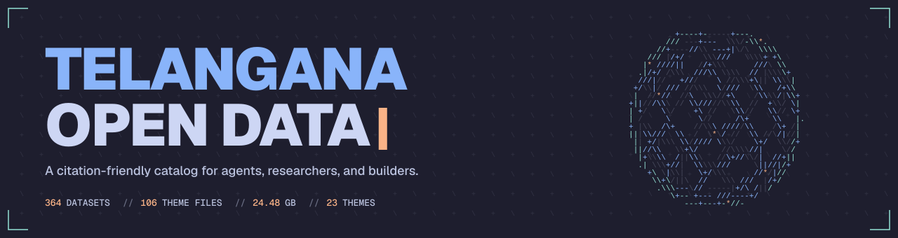

# Telangana Open Data Skill

> A local, citation-friendly guide to Telangana's open data, built for AI agents and the people who work with them.

[](#at-a-glance)
[](#at-a-glance)
[](#at-a-glance)
[](#works-with)
[](#contributing)
[](LICENSE)

Telangana publishes hundreds of datasets on
[data.telangana.gov.in](https://data.telangana.gov.in). The hard part is usually
not downloading a file. It is knowing which file you need, what columns it has,
and whether you are allowed to use it.

The portal does not make that easy. It has no full-text search, no datastore, and
no published column metadata. This skill fills the gap with a compact index of
**364 datasets** and **7,325 distribution entries**, **7,323 with a download
URL**, totaling **24.48 GB**.

It is metadata only. There are no rows, no cell values, and no runtime code. An
agent gets a map of what exists, what each file contains, and where to get it.

**Jump to:** [Who it's for](#who-its-for) · [Install](#install) · [Use it](#use-it) · [What's inside](#whats-inside) · [Works with](#works-with) · [At a glance](#at-a-glance) · [Data quality](#data-quality) · [How to cite](#how-to-cite) · [Source and license](#source-and-license) · [Contributing](#contributing)

## Who it's for

This is for anyone who needs to find the right Telangana dataset before they
need to analyze it.

- **AI builders** can give an agent reliable ground truth about what data exists,
  without building a scraper or guessing at column names.
- **Researchers** can check coverage, columns, and licensing before committing to
  a dataset, then cite the original source.
- **Founders** can look for district-level signals when sizing a market or
  testing a product idea.
- **Fast prototypers** can find a small CSV for a demo without spending the
  afternoon inside a portal.
- **Analysts** can plan joins, comparisons, and time series against files that
  actually share the columns they need.

A few prompts that work well:

> Find district-level health datasets and return their CSV URLs and columns.
>
> Which datasets cover Anganwadi centres, and what columns do they expose?
>
> Compare paddy area, production, and yield datasets across years.
>
> Give me three small CSVs with district-level data for a quick dashboard.
>
> Find datasets on urban water supply, sanitation, and municipal finance.

## Install

Install it once, globally:

```bash
npx skills add hemanth090/telangana-open-data-catalog -a '*' -g
```

`-a '*'` installs to every agent in the CLI's registry, not only the ones
detected on your machine. To install for a single agent:

```bash
npx skills add hemanth090/telangana-open-data-catalog -g -a opencode
```

The full list of agent IDs is under [Works with](#works-with).

<details>
<summary>Claude Code and Antigravity plugin installs</summary>

Claude Code:

```text
/plugin marketplace add hemanth090/telangana-open-data-catalog
/plugin install telangana-open-data@hemanth090
```

Antigravity:

```bash
agy plugin install https://github.com/hemanth090/telangana-open-data-catalog
```

</details>

ChatGPT and Claude web do not accept local skill installs. Upload
`skills/telangana-open-data/SKILL.md` with its `references/` folder if you need
the catalog there.

## Use it

Ask a normal question:

```text
Find district-wise health datasets in the Telangana catalog. Open the matching
theme file, list the CSV columns, and cite the source URL and license.
```

Here is what happens next:

1. The agent reads `SKILL.md` and finds the dataset row that matches the question.
2. It follows the row to one theme file in `references/`.
3. It reads that theme's rules, resource table, and column list.
4. It answers with the source URL and license class attached.

The agent only loads the theme it needs. The whole catalog is under a megabyte,
but a single question does not have to pay for all of it.

## What's inside

```text
.
├── assets/banner.svg         # ASCII mesh banner (Geist)
├── skills/telangana-open-data/
│   ├── SKILL.md              # index: 364 datasets, theme, size, license, link
│   └── references/           # 106 theme files with resources and columns
├── .claude-plugin/           # Claude Code plugin manifest
├── .antigravity-plugin/      # Antigravity plugin manifest
├── scripts/verify-readme.py  # recomputes and checks the README numbers
├── README.md
├── DISCLAIMER.md
└── LICENSE
```

`SKILL.md` is the index. Each row gives the dataset title, theme, resource count,
size, license class, and a link to the theme file. Each theme file contains a
short rules block, the dataset identity and source URL, a resource table, and the
column list with the number of resources in which each column appears.

## Works with

| Agent | `--agent` |
|---|---|
| Claude Code | `claude-code` |
| Codex | `codex` |
| Cursor | `cursor` |
| Grok Build | `grok` |
| Gemini CLI | `gemini-cli` |
| VS Code / Copilot | `github-copilot` |
| OpenCode | `opencode` |
| Amp | `amp` |
| Cline | `cline` |
| Goose | `goose` |
| Devin | `devin` |
| Hermes | `hermes-agent` |
| OpenClaw | `openclaw` |
| Antigravity | `antigravity` |
| Muse / Other | `universal` |

## At a glance

| Metric | Value |
|---|---:|
| Datasets | 364 |
| Theme files | 106 across 23 themes |
| Distribution entries | 7,325 |
| Entries with a download URL | 7,323 |
| Indexed size | 24.48 GB |
| Column entries | 5,829 |
| Distinct column names | 2,080 |

Every count above is reproducible from the committed index and theme files. Run
`python3 scripts/verify-readme.py` to check them.

## Data quality

- **7,208 of 7,323** URL-bearing resources were probed successfully.
- **87 CSV files** have no header. Their first row is data, so they are marked
  `no_header` and left out of the column lists instead of being given fake
  column names.
- **28 non-CSV resources** are size-only.
- **7,208 of 7,295** CSV resources have a parsed header (**98.8%**).
- **5,829 column entries** map to **2,080 distinct column names** across 364
  datasets.
- CR-only, LF, and CRLF line endings are handled.
- No rows, cell values, or sample rows are included.

<details>
<summary>How the numbers were counted</summary>

- Distribution entries and total size come from the index table in `SKILL.md`.
- Probe, CSV, and column counts come from the resource tables and `Columns:`
  lines in `references/`.
- `7,323` download-URL entries = `7,325` total minus two `no_url` probes.
- `7,295` CSV resources = `7,323` URL-bearing entries minus 28 non-CSV files.
- `7,208` parsed headers = `7,295` CSV resources minus 87 `no_header` files.
- `5,829` is the number of column entries, not distinct names. The distinct
  count is `2,080`.

</details>

## How to cite

This repository indexes metadata. Cite the dataset you actually analyze: copy
its **Source** and **License** lines from the theme file.

```text
Dataset: <title>. Source: <source URL>. Government of Telangana,
data.telangana.gov.in. License: <license class from the theme file>.
Indexed with the Telangana Open Data Skill:
https://github.com/hemanth090/telangana-open-data-catalog
```

If you use the index itself in a paper or report, link this repository and keep
the original dataset's license with the data. The index does not grant rights to
the data.

## Source and license

The metadata comes from
[data.telangana.gov.in](https://data.telangana.gov.in), published by the
Government of Telangana. This repository contains titles, resource names, URLs,
byte sizes, column names, and license labels only. It does not contain rows or
cell values.

Licenses vary by dataset. In this build: **208 open**, **3 open variants**,
**1 other-open**, **5 portal-specific**, **30 non-commercial**,
**113 unspecified**, and **4 missing**. Check the source dataset before using its
data. The non-commercial and unspecified sets are not granted for reuse here.

The skill text is Apache-2.0. That license does not grant rights to the portal
data. This project is not affiliated with or endorsed by the Government of
Telangana. See [DISCLAIMER.md](DISCLAIMER.md) for the full notice.

## Contributing

Found a dead URL, a renamed column, or a missing dataset? Open an issue with the
dataset title and source URL. If you change the index or theme files, run
`python3 scripts/verify-readme.py` before opening a PR.
